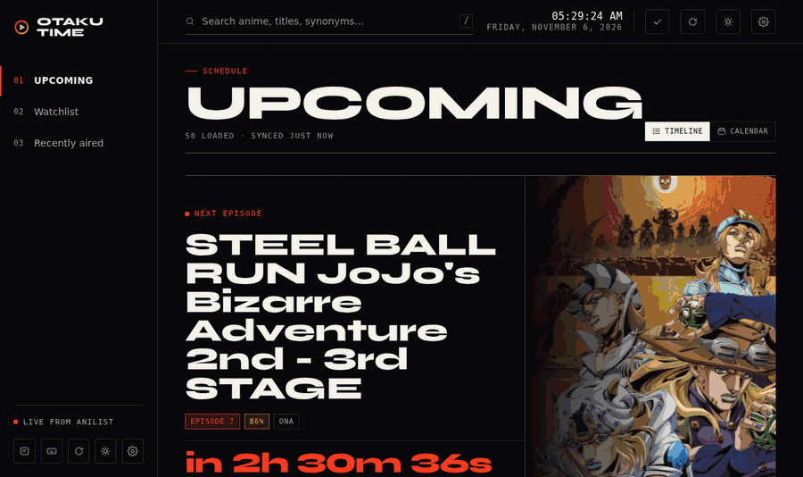
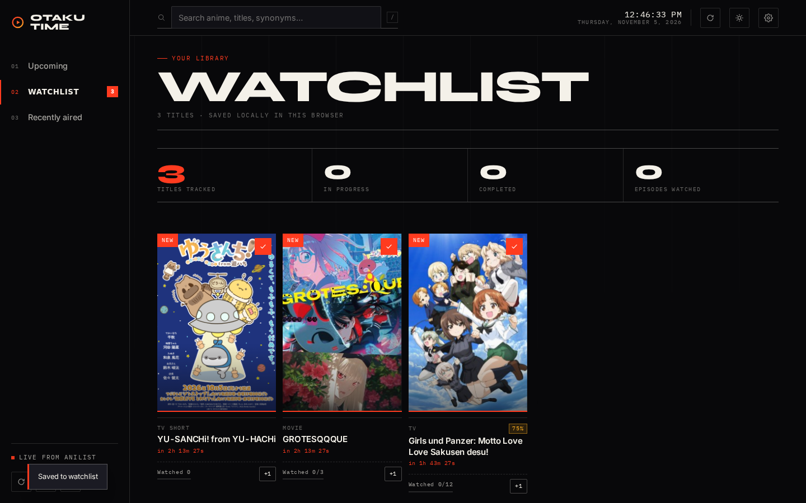
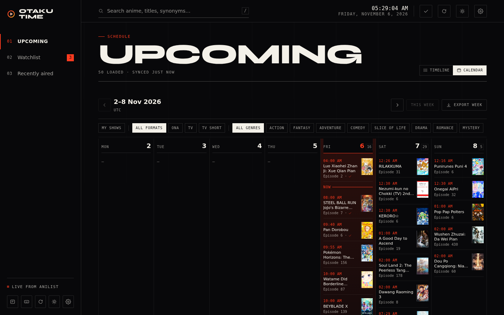
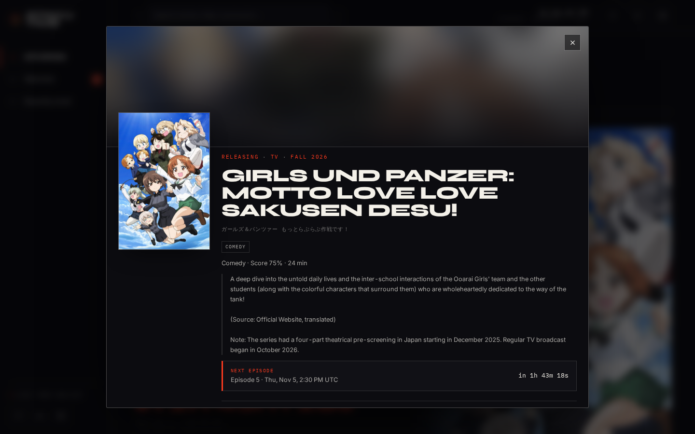

# Otaku Time

A local-first anime release almanac. Three sections — **Upcoming**, **Watchlist**, **Recently aired** — fed by the public [AniList](https://anilist.co) GraphQL API, built with plain HTML, CSS and ES modules. No accounts, no backend, no build step: your data never leaves your browser.




## Art direction — “Broadcast Almanac”

Otaku Time is designed like a printed broadcast almanac rather than a dashboard: ink-on-paper surfaces, hairline rules, a single signal-red accent, and oversized display typography (**Syne**) set against **IBM Plex Mono** micro-labels. Anime artwork is the page structure — a cinematic "next episode" feature, editorial lead panels that open each day, dense lineups beneath — so no two sections read like the same grid. Both themes are first-class: ink (default) and paper. Every motion is purposeful and fully disabled under `prefers-reduced-motion`.

| | |
| --- | --- |
|  |  |
|  |  |

## Sections

**Upcoming** is the release-discovery surface: the next episode gets a cinematic feature with a live countdown, today's already-aired titles collapse into a quiet strip, and each day opens with editorial lead panels before the lineup grid. The **Calendar** lives inside it as a view, not a fourth section — seven days, local time zone, a "now" marker, and chips to narrow to your shows, a format or a genre.

**Watchlist** is a curated collection: per-title episode progress with `+1` and direct editing (optimistic, with rollback), a personal status kept separate from AniList's airing status, sorting by recency, last update, title, airing, progress or manual order, filters for status, format, genre and progress, drag-and-drop reordering that also works from the keyboard, and a stats strip that only claims what it can prove — a "behind" count appears only when the episode total is trustworthy.

**Recently aired** is a hierarchical rundown: today, yesterday, then everything loaded, newest first, with the full loaded history reachable by scrolling.

## Around the three sections

- **Search** as you type: instant ranked results from the local pool merged with a live AniList search, synonyms included (`aot` finds *Attack on Titan*), adult titles filtered out, `<mark>` highlighting on whatever matched.
- **Detail sheet** with banner art and its dominant colour, synopsis, genres, studios, dates, synonyms, trailer, and validated streaming links — no placeholders when AniList has nothing to show.
- **Deep links**: `#show/123` opens that title directly, closing restores the section you came from, and Back/Forward behave.
- **Command palette** (`Ctrl`/`Cmd`+`K`), `?` for the shortcut map, `g u` / `g w` / `g r` to jump between sections, `j`/`k` to move through lists, `Escape` to back out. None of it fires while you are typing in a field.
- **Keyboard-and-pointer parity**: swipe on a card to bump progress or remove it, pull to refresh — and a button that does the same thing in both cases.
- **Calendar export**: an episode or the whole watchlist as `.ics`, with `VALARM` reminders, stable UIDs, correct escaping and time zones. Your phone's calendar app will nag you even when the tab is closed, which the browser cannot.
- **Offline**: the app shell is precached by a service worker, schedules are snapshotted in IndexedDB, artwork is cached stale-while-revalidate, and a stale schedule says so instead of pretending to be live. A new version surfaces as "Update ready" — never a forced reload.

## Data & privacy

- Everything lives in **your browser**: watchlist in `localStorage` (`otaku-time.watchlist.v1`, schema v3), preferences in `otaku-time.preferences.v1`, schedule snapshots in IndexedDB (`otaku-time.cache.v1`).
- Requests go **directly from your browser to `graphql.anilist.co`** — no proxy, no analytics, no cookies, no accounts.
- Imports are validated in full before anything is written, applied atomically, and never invent a status or drop a field they do not recognise. Corrupt storage is preserved on disk rather than overwritten, and reported.
- Export any time from **Settings → Export watchlist**; import the same file anywhere.
- The page ships a strict CSP (`default-src 'self'`, `script-src 'self'`, `style-src 'self'`, no inline script or `unsafe-eval`). `frame-ancestors` cannot be set from a `<meta>` tag — a static host without headers cannot express it, and that is the one directive this app cannot enforce.

## Getting started

```bash
git clone https://github.com/DarkSpirit006/otaku-time.git
cd otaku-time
npm ci                      # dev-only: Playwright and axe-core
npx playwright install      # only needed to run the e2e suite
npm run serve               # http://localhost:8080
```

Any static file server works — there is nothing to build:

```bash
python3 -m http.server 8000
```

Pick your time zone in **Settings** and start saving shows.

## Testing

```bash
npm test               # 178 unit tests — node:test, zero runtime dependencies
npm run test:e2e       # 122 Playwright tests
npm run screenshots    # refresh docs/screenshots + social card + demo GIF
```

The suites are deterministic and run offline: every AniList call is intercepted with captured fixtures, the wall clock is pinned, and images/fonts are awaited before comparing.

| Suite | Covers |
| --- | --- |
| `tests/unit/` (178) | time zones, countdowns, ICS generation, search ranking, response normalisation, the API client (cache, dedupe, retries, rate limits, cancellation), storage (migrations v1→v3, corruption, quota, import/export validation), schedule state machine, progress caps |
| `tests/e2e/app.spec.js` (27) | the three sections, search, detail, watchlist flows, deep links, palette, shortcuts, calendar, plus per-bug regressions |
| `tests/e2e/edge-cases.spec.js` (16) | API failures, rate limits, storage hazards, multi-tab sync, reduced motion, offline, infinite scroll, data portability |
| `tests/e2e/a11y.spec.js` (41) | axe-core on every primary view and dialog, in both themes, at three widths — zero serious or critical violations |
| `tests/e2e/visual.spec.js` (32) | three sections × dark/light × 360/768/1440, plus detail and search — reviewed by eye, not auto-accepted |
| `tests/e2e/offline.spec.js` (6) | the real service worker: cold start with no network, manifest and icons, deep links after reload |

Every fixed bug landed with a regression test that failed first. Two examples worth keeping in mind: the countdown ticker used to wipe the air time out of every card one second after load, and "aired earlier today" rows declared four grid tracks for five children, so a 54px thumbnail rendered 640px wide.

## Performance

Measured with Lighthouse against a local static server, mobile profile, three runs: **88 / 88 / 88 performance, 100 accessibility, 100 best practices, 100 SEO**, FCP 2.3 s, LCP 3.5 s, TBT 60–100 ms, CLS 0.

The remaining gap to 98 is **not** app scripting — total blocking time is under 100 ms. The LCP element is the feature's poster, served from AniList's CDN (`s4.anilist.co`): roughly 2.3–2.5 s of the 3.5 s is resource-load delay for third-party artwork that this app cannot compress, subset, or self-host.

I tested the obvious alternative rather than dismissing it: `?spotlight=text` puts the headline first and demotes the artwork to a strip under it (same content, CSS `order` only). Over five cold-cache runs the median LCP went from 3092 ms to 2992 ms — 100 ms, 3% — because FCP itself is 2.2–2.3 s of app shell, not artwork. Reaching 98 would mean deleting the art. Poster-first stays the default — that is a decision, recorded rather than left hanging — and the flag remains a documented, tested option for slow connections. Full method, numbers and screenshots: [`docs/experiments/spotlight-layout.md`](docs/experiments/spotlight-layout.md).

## Project structure

```
index.html            # semantic shell: topbar, sidebar, tabbar, dialogs
favicon.svg           # OT monogram
assets/fonts/         # self-hosted Syne, Inter + IBM Plex Mono (woff2)
assets/icons/         # PWA icons 192/512, maskable, apple-touch, badge
css/
  variables.css       # design tokens, both themes, motion + focus rings
  base.css            # reset, typography, ambient grid, reduced motion
  layout.css          # app grid, sidebar, topbar, clock, tabbar, toast
  responsive.css      # 1180 / 960 / 640 / 420 / 380 breakpoints
  components/         # buttons, cards, forms, dialogs, palette
  features/           # upcoming, calendar, watchlist, recently-aired, search
js/
  api/                # GraphQL queries, normalisation, cached client
  components/         # toast, icons, card builders, custom select, palette
  features/           # one module per section + detail + settings
  services/           # schedule state machine, clock, theme, notifications, PWA
  storage/            # localStorage wrappers, watchlist, prefs, IndexedDB cache
  utils/              # DOM, formatting, time zones, search ranking, router
sw.js                 # app-shell precache, offline fallback, SWR artwork
tests/                # unit/*.test.js, e2e/*.spec.js, fixtures, serve.mjs
.github/workflows/    # validate (unit + e2e) and Pages deploy
```

## Accessibility

Semantic landmarks, a skip link, visible focus rings, keyboard-operable dialogs with focus restore, an accessible combobox replacement for native selects, `aria-current` navigation state, a polite live region for status, labelled progress controls, and full `prefers-reduced-motion` support. Contrast is measured, not eyeballed: light-theme accent text is `#a51f06` and gold text `#7d4d00` so chips clear 4.5:1 on their tinted backgrounds.

## Browser support

Evergreen browsers with ES modules, `<dialog>`, IntersectionObserver and IndexedDB — anything from roughly 2022 onward. View Transitions are used where supported and fall back to an instant swap where not.

## License

[**PolyForm Noncommercial 1.0.0**](LICENSE) — Copyright 2026 DarkSpirit006 (Otaku Time).

You may use, modify and share Otaku Time for **any noncommercial purpose**: personal use, study, teaching, research, hobby projects, noncommercial open-source forks. You must keep the license text and the `Required Notice` line with any copy you pass on.

**Commercial use is not licensed.** If you want to use it at a company, in a paid product, or in anything that earns revenue, open an issue and we can agree terms separately. This is a source-available license, not an OSI-defined open-source one — that is deliberate, and it is worth reading the [full text](LICENSE) rather than assuming MIT-style terms.

---

Schedule data from [AniList](https://anilist.co). Otaku Time is a fan project and is not affiliated with AniList.
