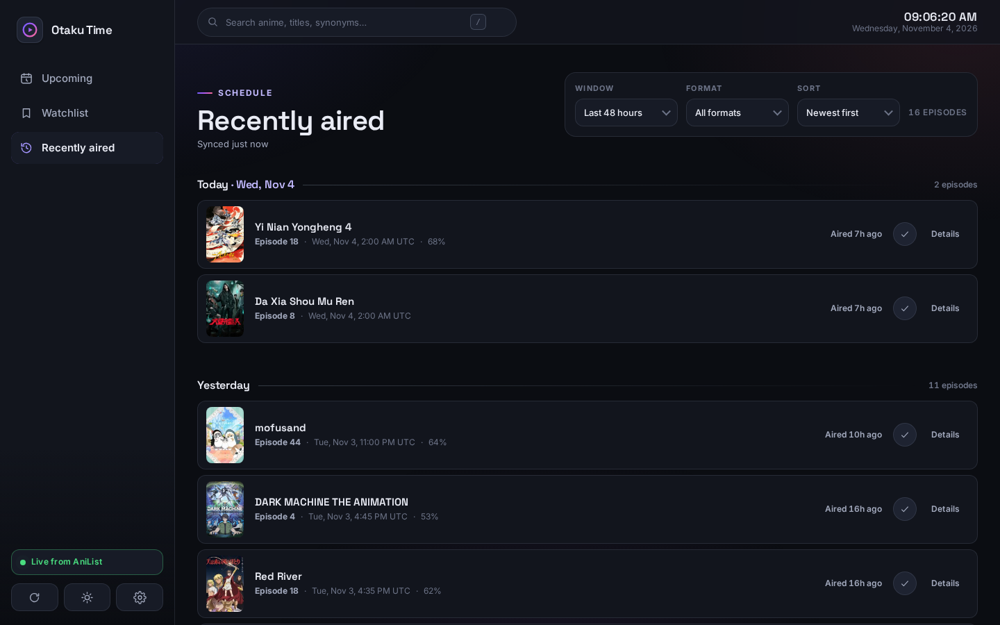
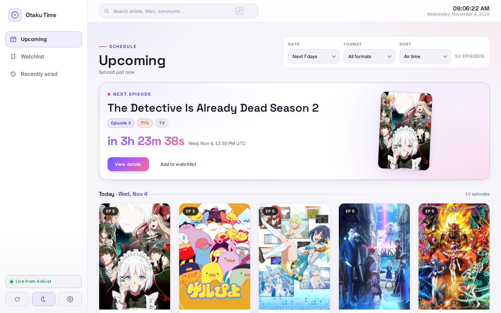

# Otaku Time

A local-first anime schedule and watchlist tracker. Three sections — **Upcoming**, **Watchlist**, **Recently aired** — powered by the public [AniList](https://anilist.co) GraphQL API, built with plain HTML, CSS and ES modules. No accounts, no backend, no build step: your data never leaves your browser.


## Features

- **Upcoming** — a “next episode” spotlight plus a date-grouped poster grid of everything airing in the next week, with live countdowns and a *Now* divider for today.
- **Watchlist** — everything you track, with stats, per-title episode progress (`+1` / direct input), completion states, and smart filters. Stored in `localStorage` and preserved across visits.
- **Recently aired** — a reverse-chronological timeline of the last 48 hours (expandable to a week or everything) grouped by day.

Around those three sections:

- **Search** as you type: instant ranked results from the local pool, merged with a live AniList search when it lands. Fuzzy matching tolerates small typos; `<mark>` highlights what matched.
- **Detail dialog** with banner art, synopsis, genres, next-episode countdown, progress controls and external links — details lazy-load when you open them.
- **Dark & light themes**, both designed first-class, with a manual toggle and an optional system-following preference. Reduced-motion users get animations disabled everywhere.
- **Rate-limit aware AniList client**: response caching with TTL, in-flight request deduplication, one automatic retry on server errors, `Retry-After`/`X-RateLimit-Reset` handling, request timeouts and cancellation.
- **Offline resilient**: schedules are snapshotted in IndexedDB, so a reload or a flaky connection still renders the last data you saw — with an honest “may be out of date” note.
- **Local-first data**: versioned storage keys, safe migrations from the previous `okaeri.*` data, corrupt-data protection (your file is never overwritten), JSON import/export with validation, and cross-tab sync via `storage` events.
- **Episode reminders** through the browser Notification API — optional, local, and permission-gated.
- **Responsive**: a sidebar on desktop, a bottom tab bar on phones, safe-area aware, and touch-friendly controls.

| Recently aired (dark) | Settings (light) |
| --- | --- |
|  |  |

## Data & privacy

- Everything lives in **your browser**: watchlist in `localStorage` (`otaku-time.watchlist.v1`), preferences in `otaku-time.preferences.v1`, schedule snapshots in IndexedDB (`otaku-time.cache.v1`).
- Legacy keys from the previous app (`okaeri.*`) are adopted automatically on first run and left intact as a backup.
- Requests go **directly from your browser to `graphql.anilist.co`**. There is no server of ours in between — no analytics, no cookies, no accounts.
- Export your data any time from **Settings → Export watchlist** (`otaku-time-watchlist.json`); import validates the schema before touching anything.

## Getting started

```bash
# Any static file server works — no build step:
npm run serve          # http://localhost:8080
# or:
python3 -m http.server 8000
```

Then open the app, pick your timezone in **Settings**, and start saving shows.

## Testing

```bash
npm ci                 # installs @playwright/test (dev only)
npm test               # unit tests — node:test, no extra dependencies
npm run test:e2e       # Playwright end-to-end suite (mocked AniList responses)
npm run screenshots    # refresh docs/screenshots from the live app
```

The e2e suite intercepts `graphql.anilist.co` with synthetic and captured fixtures, so it is deterministic and works offline. Unit tests cover formatting, time zones and countdowns, search ranking, response normalization, the API client (caching, dedupe, retries, rate limits, cancellation) and the storage layer (migrations, corruption, quota failures, import/export validation).

Continuous integration runs both suites on every push and pull request (`.github/workflows/validate.yml`). Pushes to `main` deploy to GitHub Pages via the official Pages actions (`.github/workflows/pages.yml`).

## Project structure

```
index.html            # semantic shell: topbar, sidebar, tabbar, dialogs
favicon.svg           # OT monogram
assets/fonts/         # self-hosted Inter + Space Grotesk (woff2)
css/
  variables.css       # design tokens, both themes, motion + focus rings
  base.css            # reset, typography, ambient background, reduced motion
  layout.css          # app grid, sidebar, topbar, clock, tabbar, toast
  responsive.css      # ≤960px tab-bar layout, mobile dialogs, compact grids
  components/         # buttons, cards, forms, dialogs
  features/           # upcoming, watchlist, recently-aired, search
js/
  api/                # GraphQL queries, normalization, cached client
  components/         # toast, icons, card builders, custom select
  features/           # one module per section + detail + settings dialogs
  services/           # schedule state machine, theme, clock, notifications, prefs
  storage/            # localStorage wrappers, watchlist, prefs, IndexedDB cache
  utils/              # DOM, formatting, time zones, search ranking
tests/
  unit/               # node:test suites
  e2e/                # Playwright specs + fixtures
  fixtures/           # captured AniList responses
.github/              # CI + Pages workflows, issue and PR templates
```

## Accessibility

Semantic landmarks, a skip link, visible focus rings, keyboard-operable dialogs with focus restore, an accessible combobox replacement for native selects, `aria-current` navigation state, a polite live region for status messages, and full `prefers-reduced-motion` support.

## Browser support

Evergreen browsers (Chrome, Edge, Firefox, Safari) with ES modules, `<dialog>`, IntersectionObserver and IndexedDB — i.e. anything from roughly 2022 onward.

## License

No license file has been published for this repository yet. **All rights reserved by the author until a license is chosen** — if you intend to fork, redistribute or contribute commercially, open an issue to settle licensing first.

---

Schedule data from [AniList](https://anilist.co). Otaku Time is a fan project and is not affiliated with AniList.
